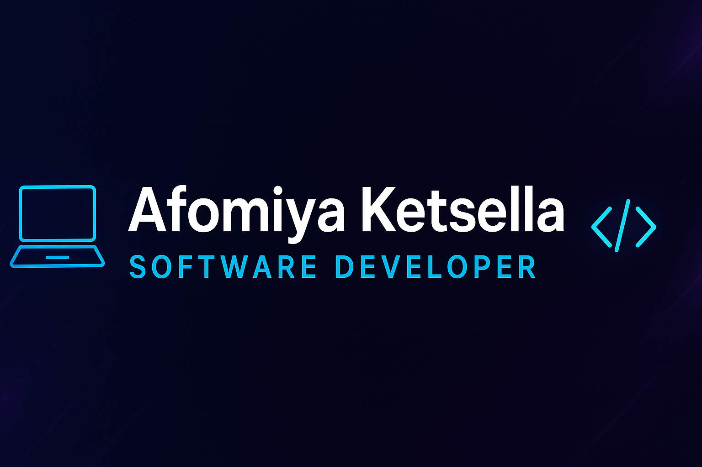

  

<h1 align="center">Afomiya Ketsella</h1>

  Software Engineer · Frontend & Mobile Development 
  Ethiopia

  
  
  

---

I build clean, user-focused web and mobile applications with React and Flutter.

  

